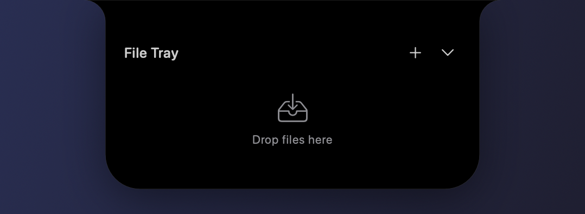

<h1>Aperture</h1>

<strong>Playback, calendar, and files at the Mac notch.</strong> 
Aperture gives you a compact view while you work and more controls when you open the island.

Apple silicon · macOS 15+

<a href="#download">Download</a> · <a href="#what-aperture-does">Features</a> · <a href="#versions">Versions</a> · <a href="docs/GETTING-STARTED.md">Getting started</a>

## Download

Get **Aperture v0.1.0** from [GitHub Releases](https://github.com/jzc9307/Aperture-DyanamicIsland-Mac/releases/tag/v0.1.0). Open the DMG, drag **Aperture** to **Applications**, and launch it. The island appears at the notch. To open preferences, choose **Settings** from the Aperture menu or right-click the island.

Aperture requires an Apple silicon Mac running macOS 15 or later. The Liquid Glass appearance requires macOS 26 or later.

## What Aperture does

### Now Playing

The compact island shows artwork and a waveform while a detected source is playing. Open it to see the title, playback progress, and the controls available for that source. Use the audio output icon to open the volume row.

In **Settings → Now Playing**, choose Apple Music, Spotify, Automatic · System, or **All Media**. All Media brings detected sources together and gives playing music priority. Swipe right over the expanded player to switch sources. In Duo, swipe over the player on the left.

When playback pauses, the compact artwork hides after your idle delay. In All Media, you can still find the paused source in the expanded player. If another source keeps playing, it can take over. Browser coverage depends on the playback details macOS or the page makes available. Standard HTML media and some custom players are supported, with controls varying by source.

### Calendar and Duo

<table>
<tr>
<td width="50%"> <strong>Calendar</strong></td>
<td width="50%"> <strong>Duo</strong></td>
</tr>
</table>

Connect your calendars to see upcoming events at the notch. Open Calendar for the day’s agenda and month view. Choose **Duo** to keep playback and your schedule side by side. Mapped events can show a time to leave when that option is enabled.

### File Tray

Drag a file onto the notch to open the tray and add it, or swipe up over the island to open the tray directly. Scroll horizontally through your items and drag one back out into a compatible app or folder. Hover over a tile to reveal its remove button. Removing a tile removes its shortcut from Aperture and leaves the original file in place. Swipe down to return to your activities.

### Hidden Menu Bar

In **Settings → Menu Bar**, turn on **Hide app icons**. **Only when space is tight** measures the room the island will need at its expanded width. Turn that option off to start with app icons tucked away. If you enable **Include Siri, Now Playing &amp; Text Input**, eligible optional controls form a second group.

| Action | Result |
| --- | --- |
| Click the arrow | Reveal app icons |
| Click the arrow again | Reveal optional controls, if that group was tucked away |
| Click the arrow after the last reveal | Tuck the items away again |
| Click the Aperture icon | Open Aperture’s menu |
| Leave the revealed items idle | Tuck them away after the delay set in **Auto-hide after** |

Live Activities, Wi-Fi, Battery, and Control Center are excluded from Aperture’s hiding rules. How many icons fit still depends on the space macOS makes available.

### Lock Screen

Choose which widgets appear in **Settings → Lock Screen**. Aperture can show Now Playing controls alongside optional status badges such as battery and Focus. The widgets enter together when you lock the Mac. On unlock, the widgets dismiss with the Lock Screen and the island plays its own unlock animation.

The clock belongs to macOS. Aperture hides its battery, Focus, and other status badges while the screen saver is active.

### Battery, Bluetooth, and Focus

<table>
<tr>
<td width="33%"> <strong>Battery</strong></td>
<td width="33%"> <strong>Bluetooth</strong></td>
<td width="33%"> <strong>Gaming Focus</strong></td>
</tr>
</table>

Aperture shows compact notifications for power changes, Bluetooth connections, and Focus. Recognized watches, mice, keyboards, controllers, and audio devices get their own symbols. Gaming Focus uses a blue indicator.

### Appearance and fit

Choose **Black**, **Clear**, **Glass**, or **Half Glass** for the expanded island. In **Settings → General → Tuning**, adjust notch width and height from −2 to +2 pixels. **Fit** matches the reported notch size at rest. The red preview follows the adjustment, with optional trackpad haptics on compatible Macs.

## Versions

| Version | What’s included | Download |
| --- | --- | --- |
| **v0.1.0** | First public release. Now Playing and All Media, Calendar and Duo, File Tray, grouped menu bar hiding, Lock Screen widgets, and notch tuning. | [Release notes and DMG](https://github.com/jzc9307/Aperture-DyanamicIsland-Mac/releases/tag/v0.1.0) |

See the [changelog](CHANGELOG.md) for the full feature list and [all GitHub releases](https://github.com/jzc9307/Aperture-DyanamicIsland-Mac/releases) for downloads.

---

Screenshots show Aperture’s demo data. The GIFs are illustrated walkthroughs. For permissions and detailed setup, see [Getting started](docs/GETTING-STARTED.md).

Aperture is closed source. This repository contains documentation and release information. See the [third-party notices](docs/THIRD-PARTY-NOTICES.txt) for credits.
