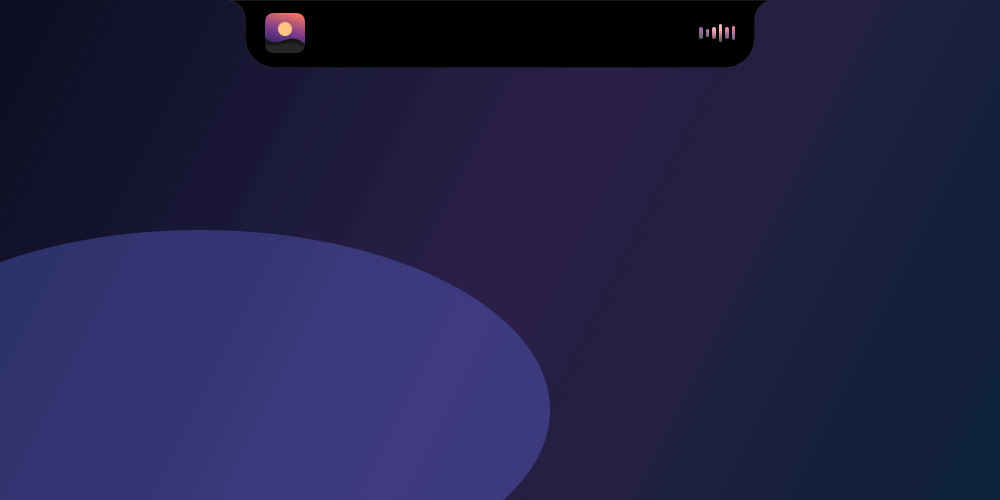
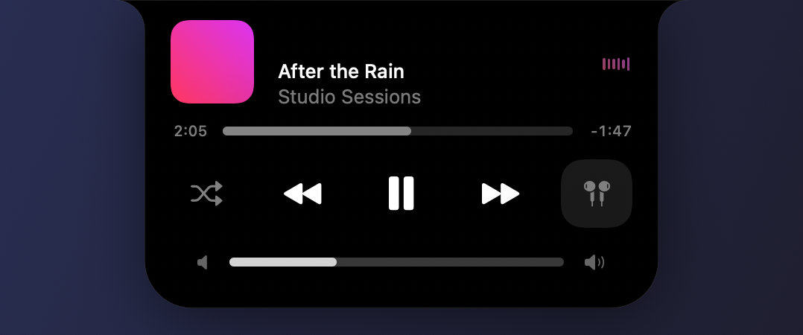
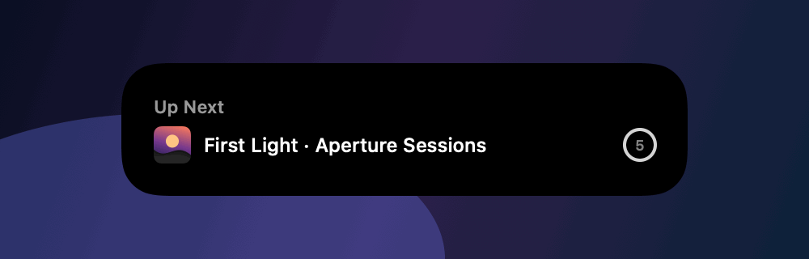
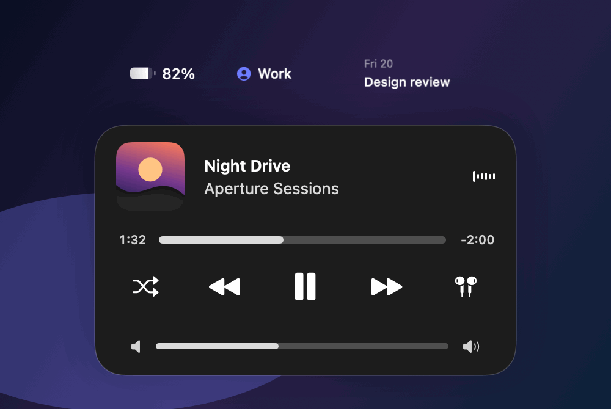
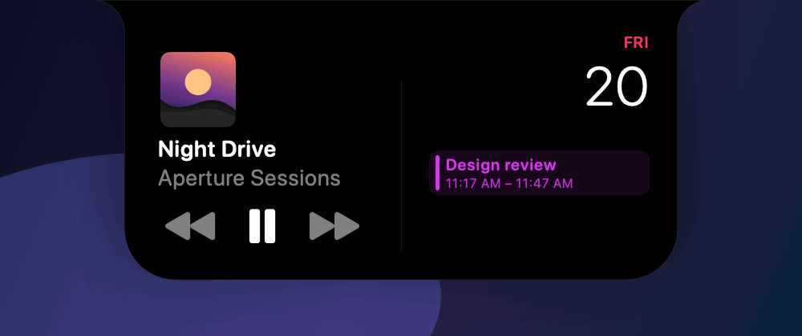
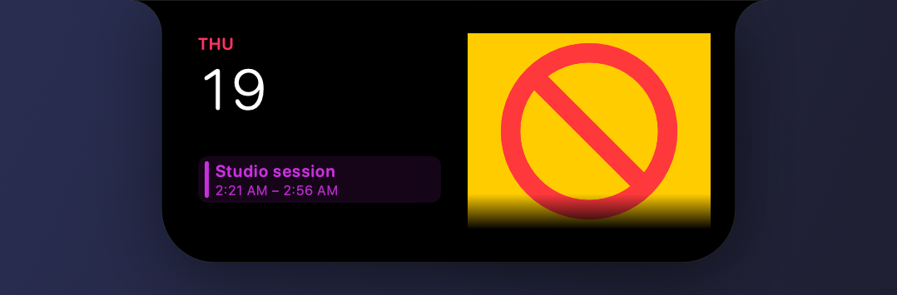
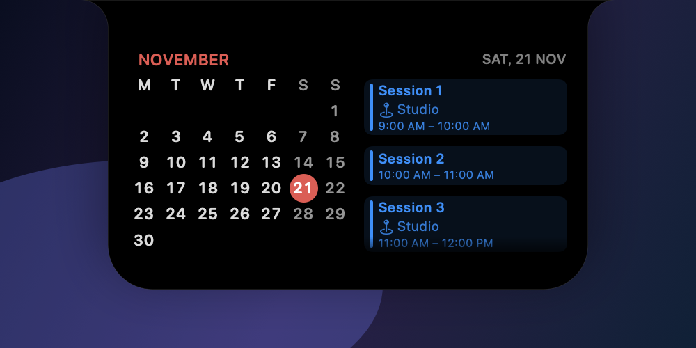
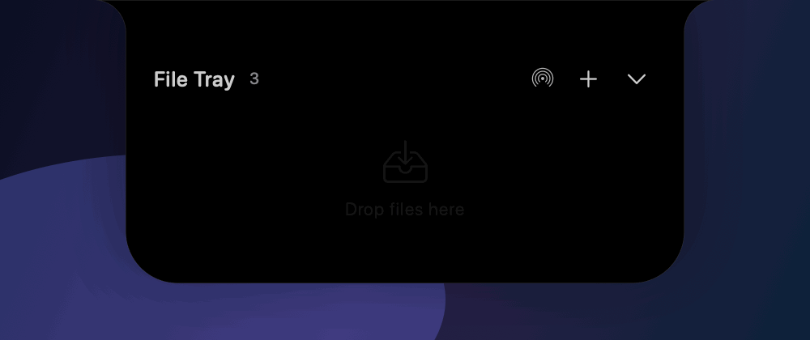
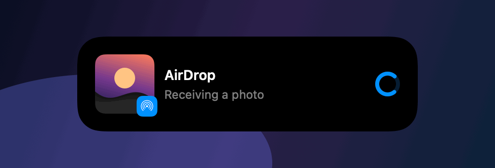
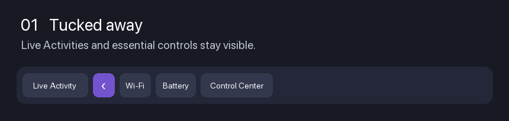

<h1>Aperture</h1>

<strong>A little more life at the top of your Mac.</strong> 
Music, your next event, quick file transfers, and useful status updates—within reach at the notch.

Apple silicon · macOS 15+ · Liquid Glass on macOS 26+

<a href="#download-and-release-status">Download</a> · <a href="#music-without-the-window-switching">Music</a> · <a href="#your-music-on-the-lock-screen">Lock Screen</a> · <a href="#a-place-to-put-things-for-a-moment">File Tray</a> · <a href="docs/GETTING-STARTED.md">Setup guide</a> · <a href="docs/releases/v0.2.0.md">v0.2.0 preview</a>

## Versions

| Version | Status | Details |
| --- | --- | --- |
| **v0.3.1** | Public release | [Download](https://github.com/jzc9307/Aperture-DyanamicIsland-Mac/releases/tag/v0.3.1) |
| **v0.3.0** | Public release | [Download](https://github.com/jzc9307/Aperture-DyanamicIsland-Mac/releases/tag/v0.3.0) |
| **v0.2.0** | Public release | [Download](https://github.com/jzc9307/Aperture-DyanamicIsland-Mac/releases/tag/v0.2.0) |
| **v0.1.0** | Public release | [Download](https://github.com/jzc9307/Aperture-DyanamicIsland-Mac/releases/tag/v0.1.0) · [Changelog](CHANGELOG.md) |

[Download the public release](https://github.com/jzc9307/Aperture-DyanamicIsland-Mac/releases/tag/v0.1.0) · [Read what’s coming in v0.2.0](docs/releases/v0.2.0.md)

Open the DMG, drag **Aperture** to **Applications**, and launch it. Click the island to open your activity. Right-click it or use Aperture’s menu to open **Settings**. See the [setup guide](docs/GETTING-STARTED.md) for permissions and gestures.

Starting with **v0.3.1**, subsequent updates can be downloaded and installed through **Settings → Update → Download Update → Install & Relaunch**. Users on v0.3.0 or earlier need one manual installation of v0.3.1 to receive this updater.

## Music without the window-switching

Artwork and a small waveform sit beside the notch while music plays. Open the island for the song title, artist, elapsed and remaining time, a seek bar, and playback controls. Close it when you’re done; the compact view keeps the essentials visible.

- **Control playback:** play or pause, go to the previous or next track, and seek through a song. The controls available depend on the source.
- **Choose the extra button:** show Favorite, Shuffle, Repeat, or Copy in **Settings → Now Playing**. Favorite is available for Apple Music.
- **Adjust volume:** click the audio-output icon to reveal the inline volume slider. Volume adjustment depends on the output device.
- **Make it yours:** choose a progress-bar style, hide extra title text, select a title badge, or disable the compact waveform.
- **Choose what stays visible:** set the compact idle delay after pausing, or hide the island’s media activity while the source app is active.

<strong>See the player with volume open</strong>

 

### One place for multiple sources

Select **Apple Music**, **Spotify**, **Automatic · System**, or **All Media** in Now Playing settings. All Media keeps detected sources together, including paused sessions. Swipe right over the expanded player to switch sources; in Duo, swipe over its left-hand music panel.

When the selected source stops, another source that is still playing can take over. Music gets priority when music and video are both active. Compatible browser players can also appear when their playback information and controls are exposed to Aperture. Source coverage and available actions vary; Aperture cannot access every session shown by macOS.

### A look at what plays next · v0.2.0

Near the end of an Apple Music track, **Up Next** can show the next song’s cover, title and artist with a countdown circle. Choose how early it appears in **Settings → Now Playing → Show Up Next before end**: **2–10 seconds**, with **5 seconds** as the default.

**Music’s Playing Next sidebar must be open.** Aperture reads that exposed queue; it does not guess from playlist order. Repeat-one, paused playback, and stale queue information do not produce a next-song announcement. Artwork availability depends on the local metadata and catalogue match.

### A waveform that follows the sound · v0.2.0 improvements

Enable **Use live waveform** to visualize system audio across six frequency bands. Bass, midrange, and treble respond independently, and compact and expanded music views receive the same live signal. The artwork supplies the color; darker colors are lifted so the bars remain visible against black.

Live visualization requires system-audio access. Audio is processed in memory and is not recorded to a file. With live mode off, Aperture uses a decorative playback animation instead.

## Your music on the Lock Screen

**The Lock Screen has its own music widget.** It brings the current cover, song title and artist, progress, and playback controls into a separate floating player while your Mac is locked.

The widget includes **shuffle, previous, play/pause, next, and the current audio-output indicator**. Use its seek bar to change position in a compatible source. Enable **Show volume control** for a volume slider below the transport buttons. Source and output-device limitations still apply.

In **Settings → Lock Screen**, you can:

| Setting | What it changes |
| --- | --- |
| **Now Playing widget** | Show or hide the separate music player. |
| **Glass / Clear** | Choose the music widget’s material style. The native Liquid Glass appearance requires macOS 26+. |
| **Idle duration** | Keep a paused track visible for your chosen period, from 1 to 60 minutes. |
| **Show volume control** | Add or remove the volume row. |
| **Vertical offset** | Move the player higher or lower on the screen. |
| **Status widgets and order** | Choose battery, connected devices, Focus, Calendar and optional weather, then arrange their order. |
| **Show on screen saver** | Allow the Lock Screen presentation during the screen saver; status badges hide while the screen saver is active. |

Widgets enter and dismiss with the lock presentation. On unlock, they leave the screen and the notch plays its unlock animation. Optional lock/unlock sounds and a keep-awake duration are available too.

**The clock, wallpaper, password field, and authentication remain part of macOS.** Aperture adds its widgets; it does not replace the system Lock Screen. The [Lock Screen setup guide](docs/GETTING-STARTED.md#lock-screen-music-and-status-widgets) explains the controls and appearance options.

## Your day, alongside your music

**Calendar** shows today’s date and events, with upcoming days in a scrolling agenda. Event cards include their time and, when available, location. Open an event from its card. In v0.3.2, swipe horizontally over the left date area or click the date to open the Calendar widget-style month grid. Choose any date to see that day’s events on the right, including past dates and later months. Scrolling over the right agenda keeps you in Calendar. Optional event indicators can be enabled.

**Duo** keeps a compact music player and today’s schedule side by side. You can check your next event and control playback in the same panel.

Choose which calendars appear, set event reminders and Quick Peek behavior, and optionally enable a **time-to-leave estimate** for mapped events. You can also show weather on an empty day after selecting a weather city.

<table>
<tr>
<td width="50%"> <strong>Agenda</strong></td>
<td width="50%"> <strong>Month view</strong></td>
</tr>
</table>

## A place to put things for a moment

Drag files toward the notch to open **File Tray**, or swipe up over the island to open it directly. Add more with **+**, scroll horizontally through the tray, and drag an item back out into a compatible app or Finder folder. Double-click a tile to open its file. Hover over it to reveal the remove button.

Removing a tile removes it from the tray; it does not delete the original file. **v0.2.0 also supports the floating screenshot thumbnail and temporary image drops**, retaining a local copy so the tray item survives after the temporary source disappears. Files stay in the tray when you close and reopen it.

Use the tray’s AirDrop button to send its files through macOS. Swipe down to return to your activities.

## AirDrop, at the notch · v0.2.0

Send files from File Tray or **Settings → AirDrop → Choose Files**. Starting with v0.3.2, macOS handles outgoing recipient selection and transfer progress; Aperture reports errors without claiming Sending or Sent from the picker callbacks. Aperture shows accepted incoming activity, with an option to expand while receiving. When a received file is available, the island can show its thumbnail and a completion state, then clear the activity.

**Accept or decline incoming requests in macOS.** The native AirDrop prompt and completion notification remain enabled. Aperture’s ring indicates transfer activity; it is not a measured byte-progress percentage. The file preview becomes available after import, rather than before consent.

## Give the menu bar some room

In **Settings → Menu Bar**, enable **Hide app icons**. Use **Only when space is tight** to tuck eligible icons away when the expanded island needs room, or turn it off to start with them tucked away. Optionally include eligible **Siri, Now Playing & Text Input** controls as a second group.

Click the arrow to reveal app icons, click again to reveal a hidden optional-controls group, and click after the final reveal to tuck the groups away. An adjustable **Auto-hide after** delay can do that for you. The separate Aperture icon opens its menu.

Live Activities, Wi-Fi, Battery, and Control Center are excluded from hiding. Icon support and available space depend on macOS; Aperture does not promise to reorder every app or keep the arrow permanently leftmost. The GIF above is a simplified explanation of the reveal sequence.

## Small updates, when they matter

<table>
<tr>
<td width="33%"> <strong>Power</strong></td>
<td width="33%"> <strong>Connections</strong></td>
<td width="33%"> <strong>Focus</strong></td>
</tr>
</table>

See charging and low-battery updates, recognized Bluetooth connections, Focus changes, and volume or brightness adjustments at the notch. Watches, mice, keyboards, controllers and audio devices have device-specific symbols. Focus options let you choose which notification types remain allowed and whether a Focus glyph replaces the waveform.

## Fit, feel, and appearance

Choose **Black, Clear, Glass, or Half Glass** for the expanded island. Adjust width and height from **−2 to +2 display pixels** in **Settings → General → Tuning**; **Fit** uses the reported notch geometry. A red preview makes the adjustment visible.

The idle island responds gently to the pointer. You can also enable hover-to-expand, set its delay, tune spring response and damping, and use trackpad haptics on compatible hardware. Visibility options cover full-screen apps, gaming, and Mission Control.

---

**About these visuals:** feature demos use fictional tracks, original sample artwork, sample events, and disposable files. They are generated from Aperture’s interface; the menu-bar GIF is a schematic. Glass appearance varies with your wallpaper and macOS version. These are not recordings of a personal desktop.

For permissions and feature setup, read [Getting started](docs/GETTING-STARTED.md). Aperture is closed source; this repository contains documentation and release information. [Third-party notices](docs/THIRD-PARTY-NOTICES.txt).
