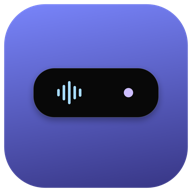
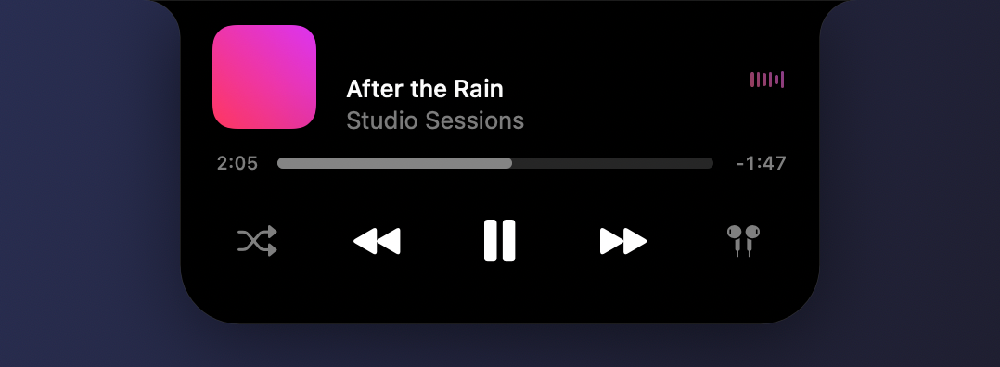
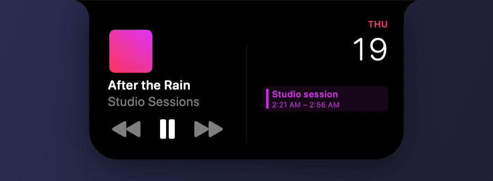

<h1>Aperture</h1>

<strong>Your Mac’s notch, with something to do.</strong> 
Playback, your next event, and a place to drop files, all within reach.

<strong>v0.1.0</strong> · Apple silicon · macOS 15+

<a href="#download">Download</a> · <a href="#gallery">Gallery</a> · <a href="docs/GETTING-STARTED.md">Getting started</a> · <a href="CHANGELOG.md">What’s new</a>

---

## Download

The first release is **v0.1.0**. When the disk image is available on [GitHub Releases](https://github.com/jzc9307/Aperture/releases), open it and drag **Aperture** to **Applications**.

Aperture runs on Apple silicon Macs with macOS 15 or later. The Liquid Glass appearance requires macOS 26 or later. Use **Settings → Update** to check GitHub for a newer release.

## Gallery

### Keep playback within reach

Open the island to control playback, seek through a track, or adjust output volume. Choose **All Media** to switch between Apple Music, Spotify, and media supplied by macOS. Swipe right over the player to switch sources.

<table>
<tr>
<td width="50%" valign="top">

 <strong>Duo</strong> Play or pause while keeping today’s schedule in view.
</td>
<td width="50%" valign="top">

 <strong>Calendar</strong> See upcoming events from the calendars you connect.
</td>
</tr>
<tr>
<td width="50%" valign="top">

 <strong>File Tray</strong> Drag items into the notch or swipe up to reach files you’ve already added.
</td>
<td width="50%" valign="top">

 <strong>Audio output</strong> Open the volume row from the audio output icon.
</td>
</tr>
<tr>
<td width="50%" valign="top">

 <strong>Battery and connectivity</strong> See power changes and Bluetooth connections with a symbol for the device.
</td>
<td width="50%" valign="top">

 <strong>Focus</strong> See when your Focus changes, including the blue Gaming indicator.
</td>
</tr>
<tr>
<td width="50%" valign="top">

 <strong>Device-specific icons</strong> Watch, mouse, keyboard, controller, and audio devices have their own symbols.
</td>
<td width="50%" valign="top">

 <strong>Fit your notch</strong> Fine-tune width and height in one-pixel steps. Zero matches the reported notch size.
</td>
</tr>
</table>

Screenshots use Aperture’s built-in demo data.

## Make it yours

- **Appearance** offers Black, Clear, Glass, and Half Glass for the expanded island.
- **Menu Bar** can tuck away eligible app icons when the expanded island needs space. Click the arrow to reveal them. Aperture’s own icon comes back with the app icons.
- **Lock Screen** adds playback controls and optional status widgets. The screen saver uses the macOS clock.
- **Privacy** gives you control over Calendar, audio capture, approximate location, and automation access. Details are in [Getting started](docs/GETTING-STARTED.md).

Aperture is closed source. This repository contains its documentation and release information. See [third-party notices](docs/THIRD-PARTY-NOTICES.txt) for credits.
